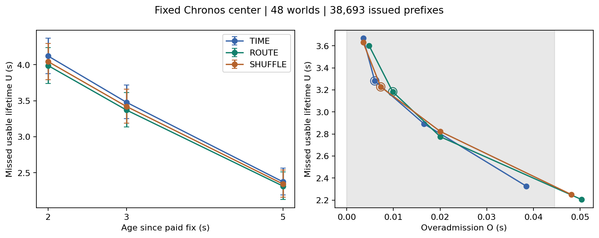
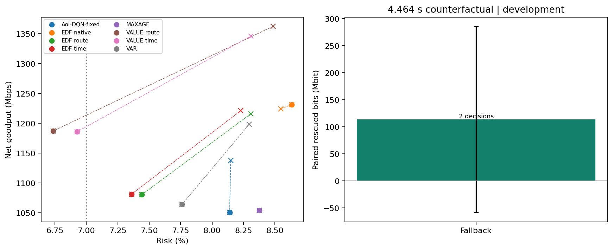

# Chronos-849 配对确认实验报告

只主张固定 Chronos 中心下的保持期判断改善。同费净吞吐收益尚未获得预冻结双判据支持。

确认集共 48 个新物理世界。E1 共有 38,693 个唯一签发前缀，主层含 1182 个前缀、48 个有效世界。E2 完成 1296 个全程端点，其中共同倍率端点 480 个。共同工作点为 0.75。每个世界内先平均 DQN 的三个冻结种子。区间采用完整物理世界配对自助法，20,000 次，种子 271127。

## 图 1　固定中心下的波束保持期

- ROUTE 对 SHUFFLE 的错失秒数改善为 0.044 [0.027, 0.063] s，过度准入增量为 0.003 [0.000, 0.008] s。0.02 秒非劣双判据通过。零容忍敏感性未通过。
- ROUTE 对 TIME 的错失秒数改善为 0.098 [0.073, 0.126] s，过度准入增量为 0.004 [0.000, 0.010] s。0.02 秒非劣双判据通过。零容忍敏感性未通过。

有效空间置换覆盖 48 个世界、1083 个主层前缀。开发冻结的非空间风险头为 TIME。缺失世界及原因见 E1/primary_coverage.csv。

## 表 1　同一 849 笔预约下的净吞吐与风险

|臂|G Mbps|R %|不可用 %|失向 %|用户 P5 Mbps|实付笔数|占时 s|绝对 7%|
|---|---:|---:|---:|---:|---:|---:|---:|---|
|AoI-DQN-fixed|1050.465|8.140|7.647|0.494|41.925|849|2.6319|未通过|
|EDF-native|1231.130|8.634|4.829|3.805|62.624|849|2.6319|未通过|
|EDF-route|1080.237|7.442|6.831|0.611|47.490|849|2.6319|未通过|
|EDF-time|1081.320|7.361|6.775|0.587|47.328|849|2.6319|未通过|
|MAXAGE|1054.040|8.377|7.905|0.472|41.757|849|2.6319|未通过|
|VALUE-route|1186.965|6.737|5.751|0.986|57.151|849|2.6319|通过|
|VALUE-time|1185.578|6.925|5.841|1.084|57.085|849|2.6319|未通过|
|VAR|1063.825|7.761|7.294|0.467|43.917|849|2.6319|未通过|

开发集冻结的最强非空间对手为 VALUE-time。以下 ΔG 为 VALUE-route 减对手，ΔR 单位为百分点。

- 对 VALUE-time，ΔG 为 1.387 [-1.568, 4.334] Mbps，ΔR 为 -0.189 [-0.291, -0.085] 个百分点。风险非劣通过。吞吐与风险双判据未通过。
- 对 EDF-route，ΔG 为 106.728 [103.022, 110.318] Mbps，ΔR 为 -0.705 [-0.798, -0.613] 个百分点。风险非劣通过。吞吐与风险双判据通过。

VALUE-route 的绝对风险为 6.737 [6.636, 6.838]%，其上界与 7% 比较，通过。开发倍率网格的 E2 共同可达风险区间为 [8.051388888888889, 8.201128472222223]。各臂边际可达区间和风险匹配权重见 design/frozen.json，确认集加权点见 E2/development_frozen_workpoints.csv。
无路线调度 VALUE-time 对冻结 AoI 强对照 AoI-DQN-fixed 的 ΔG 为 135.113 [131.017, 139.129] Mbps，ΔR 为 -1.215 [-1.322, -1.109] 个百分点。

## 图 2　选人分歧带来的通信收益

右图为离线开发诊断。分层抽定的 16 个共同付费状态中，两价值臂选人不同时才计入，共 2 个分歧预约。各候选随后均走 EDF-native，比较 4.464 秒全机群实际交付比特。置信区间按开发世界聚类。

首次单世界核验使用临时接口测试头。最终单世界核验、开发工作点及确认集使用拟合并独立校准的模型。原始场景为 16 机物理仿真、180 秒、零预热。定位成本、波束控制、风险与净速率均取自本轮逐场账本。

## E1 分层覆盖与回退

比例先在有合格查询的世界内计算，再按世界等权平均。

|分层|有效世界|前缀|查询|无时间支持回退|仅时间支持回退|10 s 右删失|
|---|---:|---:|---:|---:|---:|---:|
|all|48|6912|48384|55.6%|9.9%|19.4%|
|detour_rejoin|48|295|1202|55.3%|10.1%|26.0%|
|first_pass|48|3000|18737|75.5%|12.5%|15.4%|
|low_reuse|48|3024|21168|55.6%|8.9%|8.7%|
|natural|48|6831|25106|55.5%|9.8%|19.4%|
|no_route_support|48|4523|31661|85.0%|15.0%|11.9%|
|primary|48|1182|3095|0.8%|5.2%|60.0%|
|route_support|48|2389|16723|0.0%|0.0%|33.5%|

风险匹配若涉及两个倍率，使用开发冻结的权重，对同一物理世界两个完整闭环回执的净吞吐和风险计算加权期望。共同倍率的主结论和绝对 7% 结论均保留各自的确认集区间。

共同倍率的 VALUE-route 线上状态中，VALUE-time 在 10612/39984 个可选预约会改选用户，其中 855 笔的两个候选信息年龄相差至多 0.186 秒。该统计只比较同一个付费状态的排名，短窗因果净比特另由图 2 的反事实诊断计算。每场两类风险均以 16×9,000 个探针为分母。

正式 E1 每 1,000 个签发前缀消耗 534.2 个世界任务墙钟秒，E2 正式端点墙钟中位数 387.7 秒。采样 CPU 和进程比例内存峰值见 resources.json。训练、验证和开发诊断短分支分列，均未计作正式端点。

样本量在读取确认结果前按开发配对方差与重访覆盖确定。计算需求为 {'goodput': 3, 'risk': 2, 'life_U': 4, 'life_O': 40} 个物理世界，选择 48 个。预约算力上限对全部预设效应的规划精度充足。可检出性估算采用开发方差，正式结论以确认配对区间为准。

## 复核入口

|项目|实际提交或 SHA-256|
|---|---|
|five-mpc 基线提交|17e8144df322ef6f54cd52d399fb6a3460881535|
|本轮冻结提交|e6fe73b01fe47f78a8dfdc13f591309170ed8031|
|本轮源代码集合|0cb755880d0ba37659e58c46b43deb367b2f211f1aa6490442c5e371e5ba8a27|
|Chronos 原底座|ddcda3c7508bf2528087723e98a20707cc04b7f370ae275a9fd88078ddba4f42|
|Chronos 种子 7 微调权重|5fc8b09a9200b92e3a084602ce64a48ab50c77909b53d406982d6c2f2a5cd424|
|Chronos 原生误差管|ffa97954847a780a5f2b08b683351ee988a37c057f703d55f075a744b5ca323a|
|展开的物理场景配置|9be6925135a9a62020c615ba6b934cdb947a94d9b626bf8c3c1561a03cca26e2|
|849 笔预约表|2f55c7e415f074bcdce383830d90f9d1f2f36e58ba3adf76ca6c7094929bc32c|

模型与全部加载源码路径见 manifest.json。世界清单、比较对象、统计阈值及每个新增模型哈希见 design/frozen.json。两次 1400 核验与逐留出世界审计索引见 audits.json。
