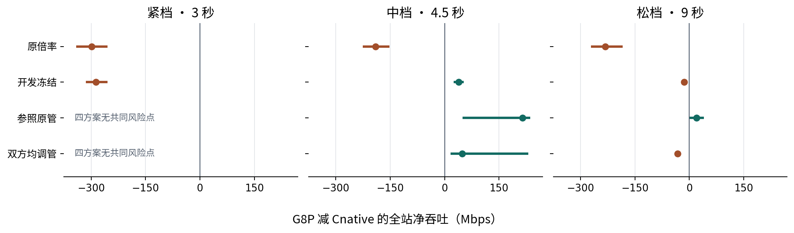

# RouteClock 8/8 正式实验总结报告

2026 年 11 月 25–27 日 · 16 机共享基站仿真 · 结题复盘

## 一、实验回答了什么

在一半机群具有可复用路线、另一半随机机动的条件下，历史路线能否改善预测？改善预测能否在感知时间有限时变成更高的通信吞吐？本轮用共同付费观测检验第一个问题，用各方法自行决定刷新的闭环仿真检验第二个问题。以下角误差越小越好，净吞吐越高越好。吞吐比较同时给出风险口径。

- **预测精度随预测时长分化。** 十个确认世界里，Joint07 在共同面板上取得最低的 1、2 秒平均角误差（0.386°、0.746°）。微调 Chronos-2 的两个管宽版本共享中心，在 5、10 秒最低（1.538°、1.966°）。G8P 相比纯 8 秒 GRU，10 秒误差从 4.840° 降到 3.481°，仍高于微调 Chronos-2。
- **中档预算给出了 G8P 最清楚的通信收益。** 在四核心方案共同可达的 3.285% 平均风险处，G8P 达到 1,550.15 Mbps。相对固定原倍率的 Cnative 高 214.41 Mbps，相对也可调管的 Cnative 高 48.43 Mbps。只用三个开发世界选好策略再冻结，G8P 在十个确认世界均取得更高吞吐，平均高 38.45 Mbps。该冻结策略下双方实际风险分别为 3.431% 和 4.938%。
- **紧档、松档的结论不同。** 紧档四核心共同风险无交集；另算 G8P 与 Cnative 两者的共同风险，G8P 比原倍率 Cnative 低 136.87 Mbps。松档在 0.783% 共同风险处，G8P 比原倍率 Cnative 高 19.88 Mbps，允许 Cnative 也调管后则低 31.71 Mbps。原倍率直接比较时，G8P 三档吞吐都更低。
- **历史窗口和误差管分别影响结果。** 五世界探索中，G8P 对重访路线的 10 秒误差在 30 秒历史下为 3.259°，180 秒历史下为 1.716°。同样截为 30 秒，Cnative 沿用旧管比重新校准多传 100.64 Mbps，风险上升 0.369 个百分点。只看吞吐会漏掉这个代价。

核心三档配对结果、区间及不可达原因见第五节。旧仓库 10/16 的两世界结果属于另一机群和训练配置；本轮独立结论以 8/8 的同世界比较为准。

## 二、实验进程与验收边界

最终清单从 11 月 25 日 15:10 到 27 日 10:49（北京时间）有任务回执，跨度约 43 小时 39 分钟。多个阶段重叠。最后一次调度启动的约 7,052 秒仅是该协调进程的运行时间。开发世界 0–2 用于选设置，确认世界 100–109 用于评分。历史实验另取世界 0 与预先固定的 100–104。

| 阶段 | 完成量 | 完成时间 | 交付与核对 |
|---|---:|---|---|
| R04 世界生成 | 13 | 25 日 15:11 | 同一命名空间、16 架飞机、共享轨迹与物理噪声 |
| R02 训练与校准 | 22 | 26 日 16:10 | 2 组样本、4 个残差网络、2 个门控、14 套主比较误差管 |
| R05 共同历史面板 | 156 | 26 日 16:07 | 12 种非门控方案 × 13 世界 |
| R06 门控面板 | 26 | 25 日 17:10 | 2 种门控 × 13 世界，每次同时保存四个对照分量 |
| R07 三档主闭环 | 2,394 | 27 日 10:35 | 紧档 910 场，中、松档各 742 场 |
| R08 窗口与换管 | 146 | 27 日 10:49 | 8 次校准、78 个面板、60 场新增闭环，180 秒参照复用主线 |
| R10 汇总 | 3 | 27 日 10:49 | 全方法、四核心、历史窗口三套正式统计 |

初始清单有 9,375 个任务。26 日调整后，加入纯路线 C，保留 8/8 主线，缩小历史消融，停止 10/16 扩展及 R09 训练配比扩展。最终 2,760 项完成，零项处于失败或前置失败；11 项在终态任务表记录两次尝试。目录中另有 1,389 份清单外 JSON，包括 1,183 个闭环回执及早期 13 方法紧档表。它们留存作追溯，未计入 2,454 场正式闭环。相同场次进入多个视图时只计一次。

中、松档在十个确认世界均保留 14 种方法的 1.00 倍。8 种方法实际有全 13 世界五倍率端点（四核心以及 Cexternal、Czero、RAFT、VECTOR）；T8、T180、G8、G180、T8P、Joint07 在 0–2、100–102 才有全倍率。由此得到全方法原倍率的十世界表、全方法调管的三世界表，以及四核心调管的十世界表。三张表回答不同的问题。

26 日将 T180、G180 的部分长窗推理移至 CUDA；最终清单各指定 24 场。开发世界 0、中档、0.35 倍的完整回放中，两者 CPU/CUDA 的更新数、风险、分段和账本相同，吞吐差均小于 0.00002 Mbps；初始中心的字节哈希有差异。并发前缀测试中三路对两路的同工作量吞吐比为 1.091；全排程的加速比未实测。[原始协议](../run/protocol.txt) · [清单](../run/manifest.json) · [回放](../run/logs/cuda_replay_check.log)

## 三、共同的观测、调度与统计口径

每个世界的 16 条轨迹按稳定路线稳定节奏、全局变速、分段变速、分段变速含停顿、局部偏离再汇入、无可复用路线分为 2/1/1/1/3/8 架。世界内用户顺序由种子置换。方法只用截至当前的付费观测。未来真值和场景类别用来评分、分组。

**共同观测。** 预热 180 秒后，服务 180 秒，每机每 3 秒刷新一次，16 机错时，每机 60 个起点，每世界 960 个，服务期感知 2.976 秒。预测在 0–10 秒每半秒一个结点。评分取 1、2、5、10 秒的方位和俯仰角残差，处理角度环绕后取二维欧氏范数并转成度。先算世界内均值，再对有样本的确认世界等权平均；下表的样本数是所有相应起点之和。31 个最终面板记录了数值复用，例如 C 可取同窗口 G8P-route、Cexternal 可取 Cnative 的相同中心。各方法的闭环仍独立校准、运行。

**闭环与账本。** 每次刷新扣 3.1 毫秒，三档 180 秒服务期的名义感知限额为 3、4.5、9 秒，离散账本容许一个刷新粒度。预测中心给出指向，误差管给出两角半宽。调度器枚举阵列和 0.5、1、2、3、5、8、10 秒有效期，用管内最坏指向损失不超过 3 dB 的候选协调刷新。过期或无动作时计不可用。感知、切换、可用数据及不可用数据时间合计 180 秒。相同规则下，各方法可产生不同的付费观测时刻。闭环发布角误差对每次实际发布评分，在不同方案间包含观测时刻选择的影响。

**指标。** 总风险是所有用户公共探针中的“不可用或实际指向损失超过 3 dB”比例，每机 9,000 个探针。几何风险为总风险减不可用风险。全站净吞吐为 16 机累计成功比特除以 180 秒，以 Mbps 计。有效窄束时间只累计分配给数据且 32×32 阵列的实际损失不超过 3 dB 的秒数。这个量反映实际传输占用，不能用 16 机保持时长之和替代。

**工作点。** 五个误差管倍率为 1.00、0.90、0.75、0.55、0.35。原倍率直接比较各自校准输出。确认集共同风险比较先求各方法实测风险区间的交集，再将 Cnative 原倍率风险投影至该交集。每种方法选一个实测端点或两个整回合端点的概率混合，最大化该平均风险下的期望吞吐。主口径在目标可达时固定 Cnative 原倍率；双方调管口径也为 Cnative 优化。混合值是实测端点加权的期望，不对应在某一回合内切换倍率。开发集 5% 策略只用世界 0–2 选端点和混合概率，冻结后评价确认集的实际风险及吞吐，确认集风险可能超过 5%。

**区间。** 按世界配对、有放回重抽 2,000 次，随机种子 270125，报差值的 2.5% 与 97.5% 分位。确认集调管每次重选目标与端点；无交集时记录不可达比例，区间仅基于可达重抽。开发冻结与原倍率用同一世界差值重抽。这些区间按各比较分别计算，未校正多重比较。9,600 个预测起点或数百万探针都共享世界内的轨迹条件，独立单位是世界。[工作点实现](../run/tables.py) · [区间实现](../run/inference_stats.py)

## 四、14 种方案的实际机制

**IMM 与路线记忆。** IMM 用三种运动模型（直行、左右转，转率 ±0.18 rad/s），根据实际观测间隔传播位置与速度状态、混合协方差。输入为测得的三维位置和径向速度，按创新似然更新模式权重并调整过程噪声，输出未来位置的加权均值。C 从同一观测流构造路线碎片，用位置偏差、航向及弧长进度匹配片段，以进度滤波预测沿路线的行进距离；对多个匹配、分支、进度模式及其不确定性加权得到路线中心 P。C 的路径更新用到 IMM 估计速度，最终发布中心只取 P。共同面板可复用 P，闭环有独立误差管。

**四个残差网络。** T8/T180 分别编码最近 8/180 秒，0.5 秒网格对应 16/360 个结点；输入是相对末次位置的三维位移（除以 30）、观测掩码和归一化时间。投影到 48 维，经两层 Transformer 编码器（4 头，前馈宽 96）取末位置表示。G8/G180 用相同输入和窗口，以 48 维单层 GRU 的最终隐藏状态替代 Transformer。四者均拼接六维 IMM 状态摘要，经 64 单元 SiLU 层输出未来 20 个三维位置修正，当前结点修正固定为零。8 秒限定神经输入；主线的 IMM 仍用 180 秒观测重建。

| 方案 | 发布中心 | 输入与区别 | 主线误差管 |
|---|---|---|---|
| IMM | 三模式位置外推 | 不规则观测与径向速度 | 独立固定形状 |
| C | 当前飞行器自身路线 P | 碎片匹配、分支及弧长进度 | 独立固定形状 |
| T8 | IMM + Transformer 残差 | 最近 16 个半秒结点 | 独立固定形状 |
| T180 | IMM + Transformer 残差 | 360 个半秒结点 | 独立固定形状 |
| G8 | IMM + GRU 残差 | 最近 16 个半秒结点 | 独立固定形状 |
| G180 | IMM + GRU 残差 | 360 个半秒结点 | 独立固定形状 |
| T8P | T8 与 P 的逐期限混合 | 复用 T8 检查点，另拟合门控 | 独立固定形状 |
| G8P | G8 与 P 的逐期限混合 | 复用 G8 检查点，另拟合门控 | 独立固定形状 |
| Cnative | 微调 Chronos-2 中位数 | 三轴同组预测，种子 7 检查点 | 原生分位宽度、归档因子 |
| Cexternal | 同一微调 Chronos-2 中位数 | 只更换宽度预测器 | 公共特征 LightGBM、归档因子 |
| Czero | 基础 Chronos-2 中位数 | 本机公开基础快照，无本任务微调 | 原生宽度、本次校准 |
| VECTOR | 预测速度积分为位移 | 速度 GRU，冻结中心，种子 7 | 逐期限逐轴固定宽度 |
| RAFT | 本机历史与检索轨迹联合预测 | 三尺度训练库检索，冻结中心，种子 7 | 逐期限逐轴固定宽度 |
| Joint07 | 在阶段 07 的 RC 中心上作联合修正 | 学习路线行进距离、分支和信任权重 | joint-refit 专用特征头 |

**拟合与模型选择。** 四个残差模型均用归档训练轨迹按编号取余分开中心拟合与管形状拟合，中心训练 2,880 条、验证 1,200 条；形状/门控 720 条，独立校准 400 条。种子 7、11、19，AdamW 学习率 0.001，批量 32，上限 50 轮，验证停滞 7 轮可提前停止。目标为 50 倍平均环绕角误差（弧度）加 0.035 倍平均位置残差范数。在所有种子、轮次中按验证损失选取。训练回执给出的种子/轮次为 T8 19/50、T180 19/50、G8 11/49、G180 19/50。

**门控证据。** T8P、G8P 在每个未来结点以 w 加权 P，以 1−w 加权短窗残差中心。选择距当前至少 10 秒的最近历史锚点，从当时可见历史重建两专家预测，用之后已经付费获得的位置比较角误差。匹配的观测与目标期限相差至多 1.5 秒，计算 log[(短专家误差+0.001)/(路线误差+0.001)] 并限幅到 ±4，无匹配时证据为零。w 为 sigmoid(期限先验截距 + 非负斜率 × 证据)。先验和斜率按期限拟合；对照包含只用短专家、只用路线、固定各半和各期限独立拟合的固定权重。门控没有接收轨迹类别或未来真值。

**Chronos 三个版本。** 同一分组中的 X、Y、Z 使用带缺失掩码的半秒网格，模型输出 20 步的 0.1、0.5、0.9 分位。中位数加末次位置构成中心；各坐标分位数相对中位数的最大偏移，由绝对角度雅可比映射为方位/俯仰半宽。Cnative 与 Cexternal 复用既有全参数微调权重，早期训练使用 AdamW、学习率 10⁻⁶，并按验证角误差选检查点。Cexternal 用公共观测/中心特征和轴标识预测对数误差尺度，逆变换并沿期限取累积最大值。Czero 从基础快照直接推理。Cnative/Cexternal 是检验相同中心、不同管宽的受控对照；Czero 同时改变中心和原生宽度。

**另外三个对照。** VECTOR 对最新速度、可用性、观测标记和观测年龄编码，白化速度并加入掩码投影，两段 GRU 生成未来 20 个速度，逆变换后按 0.5 秒积分。RAFT 在冻结训练库的 4/2/1 三种池化尺度上按共同有效位置的三维相关性检索，各尺度最多 20 个邻居，按温度 0.1 加权未来位移，再用线性头融合自身历史与检索结果。其库来自训练轨迹，与 C 的单机在线路线记忆来源不同。Joint07 用 GRU 编码近期观测及诊断特征，预测五段速度修正，对至多四条有效候选曲线做掩码 softmax，按预测弧长取点。学习到的信任度与原路线门控共同限制相对基础中心的修正，并用专用特征头预测两轴宽度。

**校准如何连接到调度。** 浅层模型、门控、C 与 IMM 按每个期限/角轴拟合误差的 90% 分位并取期限累计最大值。各模型在独立校准流上以 0.02 秒网格计算相邻结点宽度包络，在每个截止期限对两轴及整个时间前缀取最大标准化残差。400 个分数的有限样本 90% 分位取第 361 个顺序统计量，因子沿期限单调。180 秒配置中五个既有方案按代码复用其历史因子（Cnative、VECTOR、RAFT、Joint07、Cexternal）。最后再乘实验倍率。校准集覆盖率与闭环总风险的事件定义、采样分布均有区别。[中心实现](../run/center.py) · [训练与校准](../run/fitting.py) · [闭环接口](../run/experiments.py)

## 五、通信结果与风险对齐

### 全部 14 个方案，十世界、原倍率

每格为全站净吞吐 Mbps / 总风险 %。各方法的初始校准形状不同，倍率 1.00 保留各自的风险水平。

| 方案 | 紧档 3 秒 | 中档 4.5 秒 | 松档 9 秒 |
|---|---|---|---|
| IMM | 200.44 / 83.153 | 298.56 / 74.765 | 568.36 / 49.597 |
| C | 619.17 / 23.454 | 873.01 / 0.873 | 1,382.62 / 0.036 |
| T8 | 599.82 / 31.577 | 880.97 / 0.265 | 1,378.11 / 0.007 |
| T180 | 900.21 / 3.328 | 1,402.00 / 0.468 | 1,565.66 / 0.209 |
| G8 | 598.12 / 32.694 | 877.90 / 0.260 | 1,381.62 / 0.000 |
| G180 | 880.81 / 0.623 | 1,129.54 / 0.871 | 1,309.70 / 2.305 |
| T8P | 833.58 / 0.682 | 1,146.20 / 0.361 | 1,292.43 / 2.366 |
| G8P | 870.58 / 0.656 | 1,145.52 / 0.397 | 1,313.49 / 1.882 |
| Czero | 662.65 / 16.005 | 938.43 / 4.252 | 1,331.35 / 2.496 |
| Cnative | 1,168.65 / 3.757 | 1,335.74 / 3.285 | 1,544.97 / 0.783 |
| Cexternal | 1,276.87 / 5.844 | 1,409.23 / 4.406 | 1,590.83 / 1.374 |
| VECTOR | 881.15 / 0.619 | 1,097.80 / 2.286 | 1,567.36 / 0.057 |
| RAFT | 881.89 / 0.548 | 1,098.67 / 2.123 | 1,568.73 / 0.014 |
| Joint07 | 1,070.93 / 4.267 | 1,301.14 / 3.486 | 1,511.47 / 1.163 |

Cexternal 三档的原倍率吞吐均最高。它与 Cnative 的共同面板角误差完全一致，但紧档多传 108.23 Mbps，总风险也从 3.757% 升至 5.844%。在十世界紧档开发冻结比较中，Cnative 以 4.908% 确认风险达到 1,391.38 Mbps，G180 为 1,340.45 Mbps / 3.11%，RAFT 为 1,339.00 Mbps / 4.44%；IMM 和 Cexternal 在开发集 5% 上限下没有可选端点。不同风险的行不能直接回答同风险谁更优。[全方法表](../run/results/all_main/table1.csv)

### G8P 对 Cnative 的逐世界配对

下表列出十世界均值，Δ = G8P − Cnative，单位 Mbps。括号为配对 95% 区间。“参照原管”按共同风险优化 G8P，并在 Cnative 原倍率目标可达时保持该倍率。“均调管”允许双方优化。紧档四核心共同风险不可达，不填推测值。

| 预算 | 策略 | G8P | Cnative | Δ Mbps | 95% 区间 |
|---|---|---|---|---|---|
| 紧 | 原倍率 | 870.58 | 1,168.65 | -298.07 | [-340.70, -254.69] |
| 紧 | 开发冻结 | 1,104.66 | 1,391.38 | -286.72 | [-313.96, -255.25] |
| 紧 | 参照原管 | 无共同点 | — | — | — |
| 紧 | 均调管 | 无共同点 | — | — | — |
| 中 | 原倍率 | 1,145.52 | 1,335.74 | -190.22 | [-225.45, -152.08] |
| 中 | 开发冻结 | 1,570.67 | 1,532.22 | +38.45 | [+25.11, +52.85] |
| 中 | 参照原管 | 1,550.15 | 1,335.74 | +214.41 | [+49.31, +235.74] |
| 中 | 均调管 | 1,550.15 | 1,501.72 | +48.43 | [+16.65, +230.44] |
| 松 | 原倍率 | 1,313.49 | 1,544.97 | -231.48 | [-270.63, -183.53] |
| 松 | 开发冻结 | 1,587.40 | 1,601.42 | -14.02 | [-17.54, -11.49] |
| 松 | 参照原管 | 1,564.84 | 1,544.97 | +19.88 | [+1.16, +40.76] |
| 松 | 均调管 | 1,564.84 | 1,596.55 | -31.71 | [-35.62, -28.51] |

中档原倍率下，G8P 风险为 0.398%，Cnative 为 3.285%；前者用时 4.435 秒、有效窄束 0 秒，后者用时 3.975 秒、有效窄束 70.997 秒。在共同风险点，G8P 放宽可用传输动作，感知 4.391 秒、有效窄束 155.269 秒。双方均调后 Cnative 感知 3.459 秒、有效窄束 140.808 秒。该工作点两者几何风险分别为 2.841%、1.422%，不可用风险相应约为 0.444%、1.863%。同样的总风险可以由不同事件构成。

松档下，双方均调的 Cnative 有效窄束为 165.045 秒，G8P 为 145.150 秒，对应的净吞吐差为 −31.71 Mbps。开发 5% 冻结后 G8P 在紧、中、松档分别有 0/10、10/10、0/10 个世界的吞吐高于 Cnative。紧档 G8P 的确认风险为 5.262%，已超过开发选择时的 5% 上限。

### 可达性、其他核心方案与紧档补算

| 双方均调管 | 平均风险 | 纯路线 C | IMM | G8P | Cnative |
|---|---|---|---|---|---|
| 中档 | 3.285% | 1,374.58 | 1,112.67 | 1,550.15 | 1,501.72 |
| 松档 | 0.783% | 1,565.35 | 1,204.57 | 1,564.84 | 1,596.55 |

十世界四核心中档交集仅为 [3.229%, 3.431%]。配对重抽时 15.8% 的样本没有共同风险，两个中档调管区间都只代表其余可达样本。松档交集为 [0.538%, 2.348%]，重抽均可达。紧档 IMM 五个端点的最低风险为 33.057%，已高于 Cnative 的最高 7.453%，四核心与全 14 方法均无法作全组匹配；原倍率 IMM 的 83.153% 风险几乎全部来自服务不可用。

**紧档两方案事后补算。** 单独问“紧档 G8P 和 Cnative 本身能否匹配”时，移除其他方案的交集约束，两者可在 3.757% 处比较。G8P 用 0.35/0.90 倍的整回合混合（0.90 倍占 57.38%），期望 1,031.78 Mbps。固定原倍率 Cnative 为 1,168.65 Mbps，Δ −136.87 [−168.47, −102.26]；双方均调时 Cnative 为 1,232.19 Mbps，Δ −200.41 [−251.34, −119.77]。两组重抽均全部可达。此项在复盘时计算，使用的仍是相同十个确认世界，不能当成新的独立验证。[补算脚本](tight_pair.py) · [端点与区间](tight_pair.csv)

全 14 方法的中、松档全倍率可比集合只有三个确认世界。中档最大下界 3.850% 高于最小上界 2.398%；松档交集 [0.946%, 2.309%]，目标被投影至 0.946%。该点 Cnative 1,605.36、Joint07 1,597.93、Cexternal 1,597.57、G8P 1,574.88 Mbps。三个世界的估计与四核心十世界的目标和不确定度均不同。[三世界结果](../run/results/all_main/middle_loose_sweep/table1.csv) · [核心十世界回执派生表](../run/results/core_main/policy_worlds.csv)

## 六、预测误差、门控与实际发布

同一观测条件，每方法 9,600 个起点、160 架次、10 世界。表中为平均二维角误差（度）。

| 方案 | 1 秒 | 2 秒 | 5 秒 | 10 秒 |
|---|---|---|---|---|
| IMM | 0.490 | 1.055 | 3.200 | 6.385 |
| C | 0.465 | 0.899 | 2.208 | 3.842 |
| T8 | 0.962 | 1.840 | 3.433 | 4.662 |
| T180 | 0.466 | 0.938 | 1.871 | 2.783 |
| G8 | 0.707 | 1.413 | 3.245 | 4.840 |
| G180 | 0.543 | 1.038 | 2.120 | 2.985 |
| T8P | 0.550 | 0.961 | 2.192 | 3.110 |
| G8P | 0.464 | 0.896 | 2.155 | 3.481 |
| Czero | 0.613 | 0.980 | 1.878 | 2.422 |
| Cnative | 0.424 | 0.755 | 1.538 | 1.966 |
| Cexternal | 0.424 | 0.755 | 1.538 | 1.966 |
| VECTOR | 0.519 | 0.998 | 2.270 | 3.489 |
| RAFT | 0.554 | 1.022 | 2.041 | 2.593 |
| Joint07 | 0.386 | 0.746 | 1.842 | 3.067 |

G180 相比 G8 的 10 秒误差从 4.840° 降到 2.985°；T180 相比 T8 从 4.662° 降到 2.783°。同一家族的长、短版本分别训练并各自选检查点，这一对照包含输入时长与选定参数两方面差异。微调 Chronos 比基础版在所有四个期限都更准，10 秒差约 0.456°。短期表现最好的 Joint07 在 10 秒为 3.067°，短期排序无法代替长期排序。

### 分组检验与门控消融

| 分组 | 方案 | 起点 | 1 秒 | 2 秒 | 5 秒 | 10 秒 |
|---|---|---|---|---|---|---|
| 随机 | G8P | 4800 | 0.592 | 1.232 | 3.083 | 4.903 |
| 随机 | Cnative | 4800 | 0.590 | 1.130 | 2.428 | 2.992 |
| 随机 | C | 4800 | 0.628 | 1.285 | 3.331 | 5.917 |
| 重访 | G8P | 4683 | 0.332 | 0.548 | 1.212 | 2.042 |
| 重访 | Cnative | 4683 | 0.255 | 0.374 | 0.644 | 0.935 |
| 重访 | C | 4683 | 0.297 | 0.502 | 1.070 | 1.746 |
| 偏离 | G8P | 117 | 0.538 | 1.027 | 1.863 | 2.855 |
| 偏离 | Cnative | 117 | 0.405 | 0.617 | 0.846 | 1.171 |
| 偏离 | C | 117 | 0.544 | 0.968 | 1.729 | 2.728 |
| 偏离初期 | G8P | 33 | 0.477 | 0.935 | 1.323 | 2.179 |
| 偏离初期 | Cnative | 33 | 0.325 | 0.537 | 0.796 | 1.120 |
| 偏离初期 | C | 33 | 0.439 | 0.825 | 1.031 | 1.719 |

随机组与重访组的重点期限分别为 1–2 秒、5–10 秒。G8P 在随机组 1 秒几乎追平 Cnative，2 秒落后约 0.102°；重访组 10 秒误差高 1.107°。纯 C 在重访组优于 G8P，但随机组 10 秒比 G8P 高约 1.014°。正式面板只有 117 个偏离起点，其中 33 个在偏离起始两秒内；后者是前者的子集，不可相加。首次经过组没有可用起点。偏离组按世界等权，小组事件数尤其需要随均值一起阅读。

| 中心组合 | 1 秒 | 2 秒 | 5 秒 | 10 秒 |
|---|---|---|---|---|
| G8P-pure | 0.707 | 1.413 | 3.245 | 4.840 |
| G8P-route | 0.465 | 0.899 | 2.208 | 3.842 |
| G8P-half | 0.504 | 1.010 | 2.379 | 3.688 |
| G8P-fixed | 0.457 | 0.893 | 2.163 | 3.610 |
| G8P | 0.464 | 0.896 | 2.155 | 3.481 |
| T8P-pure | 0.962 | 1.840 | 3.433 | 4.662 |
| T8P-route | 0.465 | 0.899 | 2.208 | 3.842 |
| T8P-half | 0.604 | 1.167 | 2.373 | 3.348 |
| T8P-fixed | 0.469 | 0.901 | 2.137 | 3.350 |
| T8P | 0.550 | 0.961 | 2.192 | 3.110 |

动态门控比固定逐期限融合在总体 10 秒上更好，G8P 改善约 0.129°，T8P 改善 0.240°。G8P 的总体 1 秒反而比固定权重高约 0.007°。G8P 随机组 10 秒从固定融合的 5.225° 降到 4.903°，重访组则从 1.980° 升到 2.042°。这些结果限定了门控收益出现的期限与场景。[分组与样本量](../run/results/all_main/tight_full/angles.csv)

### 实际发布流，十世界原倍率

| 预算 | 方案 | 1 秒 | 2 秒 | 5 秒 | 10 秒 | 不可用 % |
|---|---|---|---|---|---|---|
| 紧 | G8P | 0.470 | 0.911 | 2.193 | 3.503 | 0.517 |
| 紧 | Cnative | 0.468 | 0.870 | 1.914 | 2.483 | 3.557 |
| 紧 | C | 0.470 | 0.905 | 2.224 | 3.850 | 23.416 |
| 紧 | IMM | 0.478 | 1.032 | 3.148 | 6.292 | 83.153 |
| 中 | G8P | 0.429 | 0.822 | 2.043 | 3.303 | 0.119 |
| 中 | Cnative | 0.451 | 0.840 | 1.946 | 2.572 | 3.075 |
| 中 | C | 0.421 | 0.814 | 2.066 | 3.623 | 0.831 |
| 中 | IMM | 0.361 | 0.800 | 2.666 | 5.566 | 74.765 |
| 松 | G8P | 0.397 | 0.762 | 1.912 | 3.241 | 1.817 |
| 松 | Cnative | 0.424 | 0.795 | 1.907 | 2.548 | 0.622 |
| 松 | C | 0.389 | 0.757 | 1.968 | 3.503 | 0.000 |
| 松 | IMM | 0.356 | 0.772 | 2.557 | 5.345 | 49.597 |

不同方案会选择不同刷新时刻。紧档 Cnative 的发布 10 秒误差为 2.483°，高于其共同面板 1.966°；G8P 对应 3.503° 和 3.481°。松档 IMM 发布 1 秒误差为 0.356°，同时约一半公共探针没有可用动作。仅在实际发布上评分会遗漏可用性，需同时阅读探针风险和服务账本。[逐场发布误差](../run/results/core_main/endpoints.csv)

## 七、历史窗口与管宽迁移

世界 100–104 等权；每方法、每种窗口有 4,800 个共同起点，其中随机 2,400、重访 2,347、偏离 53（含刚偏离 16）。60 秒只做共同面板。下表针对不同分组列出预设重点期限，单位度。

| 方案 | 历史（秒） | 随机 1 秒 | 随机 2 秒 | 重访 5 秒 | 重访 10 秒 |
|---|---|---|---|---|---|
| G8P | 30 | 0.509 | 1.094 | 1.821 | 3.259 |
| G8P | 60 | 0.535 | 1.123 | 1.460 | 2.446 |
| G8P | 120 | 0.569 | 1.178 | 1.072 | 1.810 |
| G8P | 180 | 0.575 | 1.195 | 0.990 | 1.716 |
| Cnative | 30 | 0.574 | 1.139 | 1.416 | 2.381 |
| Cnative | 60 | 0.557 | 1.105 | 0.779 | 1.261 |
| Cnative | 120 | 0.551 | 1.081 | 0.568 | 0.875 |
| Cnative | 180 | 0.569 | 1.087 | 0.520 | 0.804 |
| C | 30 | 0.511 | 1.105 | 1.780 | 3.621 |
| C | 60 | 0.548 | 1.148 | 1.311 | 2.316 |
| C | 120 | 0.597 | 1.224 | 0.918 | 1.490 |
| C | 180 | 0.612 | 1.244 | 0.816 | 1.358 |
| IMM | 30 | 0.577 | 1.273 | 2.081 | 4.249 |
| IMM | 60 | 0.587 | 1.291 | 2.084 | 4.248 |
| IMM | 120 | 0.588 | 1.293 | 2.084 | 4.247 |
| IMM | 180 | 0.588 | 1.293 | 2.084 | 4.247 |

G8P 从 180 秒截至 30 秒，随机组当前机动的 1/2 秒角误差小幅降低，重访组 5/10 秒明显变大。单独缩短其路线记忆与门控证据、保留 180 秒运动状态后，相对全部截成 30 秒的总体 10 秒误差仅增加约 0.003°，重访组约增加 0.001°。在这五个世界里，该操作基本保留了截短路线窗口的效果；它没有单独分解路线记忆与门控证据各自的因果贡献。

### 紧档、原倍率，按窗口重新校准

| 方案 | 历史（秒） | 风险 % | 吞吐 Mbps | 感知秒 | 发布 10 秒（°） |
|---|---|---|---|---|---|
| G8P | 30 | 0.572 | 889.41 | 2.945 | 4.244 |
| G8P | 120 | 0.647 | 889.53 | 2.945 | 3.410 |
| G8P | 180 | 0.613 | 874.85 | 2.945 | 3.279 |
| Cnative | 30 | 4.131 | 1,038.37 | 2.615 | 3.198 |
| Cnative | 120 | 3.741 | 1,173.67 | 2.618 | 2.453 |
| Cnative | 180 | 3.659 | 1,204.85 | 2.622 | 2.399 |
| C | 30 | 0.641 | 889.26 | 2.945 | 5.071 |
| C | 120 | 0.640 | 666.54 | 2.945 | 3.807 |
| C | 180 | 22.024 | 628.64 | 2.985 | 3.608 |
| IMM | 30 | 32.426 | 605.82 | 2.985 | 5.832 |
| IMM | 120 | 66.215 | 300.88 | 3.001 | 5.873 |
| IMM | 180 | 83.153 | 200.83 | 3.001 | 5.873 |

30 秒相对 180 秒，Cnative 的净吞吐降低 166.48 Mbps，实际发布 10 秒误差从 2.399° 增至 3.198°。G8P 的共同面板和发布长期误差均随截短而变大，但吞吐增加 14.56 Mbps。C 与 IMM 的短窗在紧档原倍率下还能明显改善风险与吞吐。这个比较同时改变历史、按窗校准出的管以及后续刷新流，无法把通信改善归给中心精度。

固定为 30 秒历史，只改变误差管来源：Cnative 沿用 180 秒管得到 1,139.01 Mbps / 4.500%，相对 30 秒重校准增加 100.64 Mbps、0.369 个百分点；G8P 沿用旧管得 874.02 Mbps / 0.572%，吞吐少 15.39 Mbps，风险差在表中为零。只对这两方法设置换管对照。五个确认世界只支持探索性解释。[逐世界窗口配对](../run/results/core_history/worlds.csv) · [换管结果](../run/results/core_history/tube_confirmation.csv)

## 八、结论的适用范围与复核

对 8/8 机群，路线先验确实帮助短窗网络改善长期预测，但单独的中心误差无法决定吞吐。若评价目标是中档预算下的风险与吞吐，G8P 在确认集匹配、对称调管、开发集冻结三种比较下均取得正吞吐差。紧档的两方案补算和松档的对称调管给出相反方向。部署式比较最接近本实验中的开发冻结口径，确认集选工作点的数字更适合描述这些世界的可达性能。

结论限于该 8/8 轨迹组成、共享基站、成本模型和五个离散倍率；没有现场通信测量。固定观测面板、实际发布评分及公共探针的分母各异。分组事件不均衡，历史窗口只有五个确认世界，中松档全方法扫倍率只有三个。10/16 扩展、训练机群配比效应和早期样本中观察到的 4.505208% 工作点均未获本轮独立复刻。

复核程序按最终清单逐项核对状态、回执身份、共同面板起点/误差和闭环时间、比特、风险账本；从回执在临时目录重新生成全方法、四核心及窗口表，38 张正式 CSV 在指定数值容差内一致。本次复盘重新计算了统计量，未重新训练或运行 2,454 场物理仿真。完整回执、源码、权重、世界文件、分包校验和前置依赖入口见版本目录。[核验程序](../verify.py) · [核验记录](audit.txt) · [新增内容目录与复核命令](../README.md)
